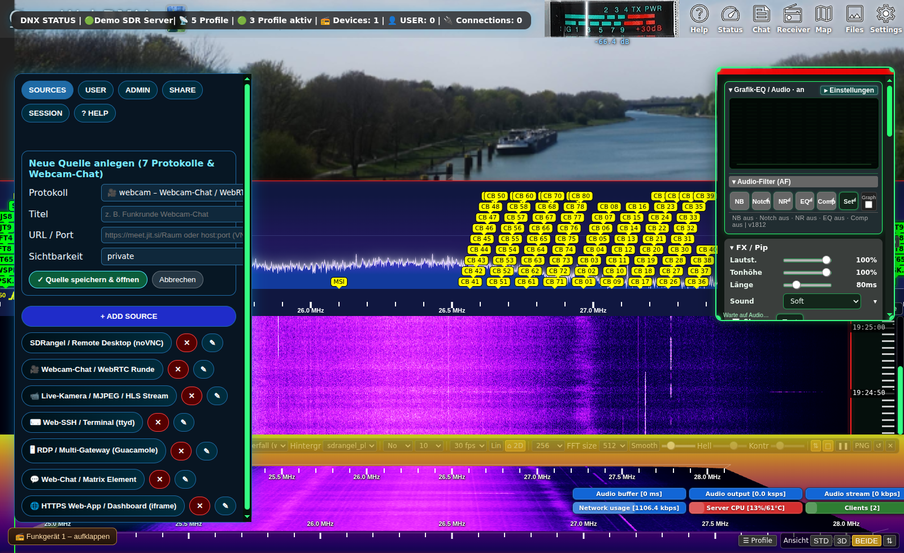
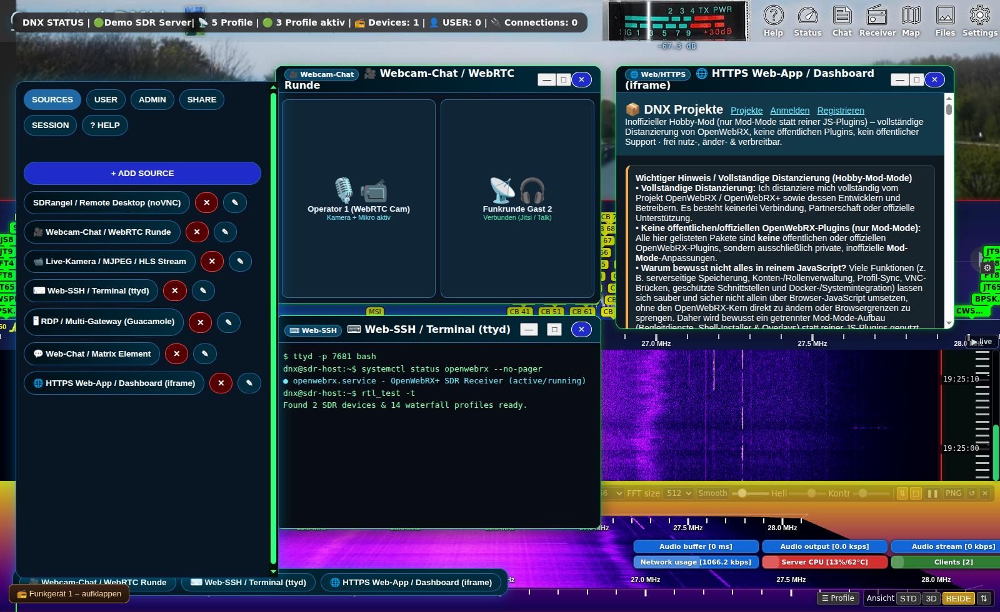

# DNX Remote VIEW (`v1.3.0`)

<!-- DNX-DISCLAIMER-START -->
> **Wichtiger Hinweis / Vollständige Distanzierung (Hobby-Mod-Mode)**
>
> - **Vollständige Distanzierung:** Ich distanziere mich in jeder Hinsicht vollständig vom Projekt **OpenWebRX / OpenWebRX+** sowie dessen Entwicklern und Betreibern. Es besteht keinerlei Verbindung, Zusammenarbeit, Prüfung, Befürwortung oder Partnerschaft.
> - **Keine öffentlichen/offiziellen OpenWebRX-Plugins (nur Mod-Mode):** Bei diesem Projekt handelt es sich ausdrücklich **nicht** um ein öffentliches oder offizielles Plugin von OpenWebRX, sondern ausschließlich um einen privaten, inoffiziellen **Mod-Mode** (Eigenmodifikation).
> - **Warum bewusst kein reines Browser-JavaScript (Mod-Mode-Architektur):** Viele Funktionen (z. B. serverseitige Speicherung, Konten-/Rollenverwaltung, Profil-Synchronisation, VNC-/websockify-Brücken, geschützte Schnittstellen, Docker-/Systemintegration und stabile UI-Anpassungen) lassen sich sauber und sicher nicht allein über simples Client-JavaScript umsetzen, ohne den OpenWebRX-Kern umzubauen oder Browsergrenzen zu umgehen. Deshalb setzt dieses Projekt bewusst auf getrennte Begleitmodule, Shell-Installer und Dienste im **Mod-Mode** statt alles künstlich in reines JavaScript zu pressen.
> - **Kein öffentlicher Support & keine Haftung:** Es gibt **keinen öffentlichen Support**, keine Garantie und keine Haftung. Nutzung, Installation und Anpassung erfolgen vollständig auf eigene Gefahr (immer vorher Backups anlegen und zunächst im eigenen Testsystem prüfen).
> - **Reines Hobbyprojekt – frei nutzbar, änderbar & verbreitbar:** Dieses Projekt entsteht ausschließlich aus reinem Hobby und Interesse am gemeinsamen Funk-/SDR-Hobby. Es steht ausdrücklich frei zur Verfügung und darf frei genutzt, weiterverbreitet, verändert und verbessert werden.
<!-- DNX-DISCLAIMER-END -->

> **Important Notice / Full Disassociation (Hobby Mod-Mode Only)**
>
> - **Full Disassociation:** I completely disassociate myself from **OpenWebRX / OpenWebRX+** and its developers/maintainers. There is no affiliation, endorsement, review, or partnership of any kind.
> - **No Official/Public OpenWebRX Plugins (Mod-Mode Only):** These files are **not** official or public OpenWebRX plugins, but purely unofficial hobby modifications (*mod-mode*).
> - **Why Not Everything in Pure Browser JavaScript:** Many features (server-side persistence, account/role management, profile syncing, VNC/websockify bridges, protected endpoints, and Docker/host integration) cannot be implemented cleanly or reliably in client-side JavaScript alone without modifying the OpenWebRX core or hitting browser/security limits. That is why this project intentionally uses separate companion scripts, services, and *mod-mode* hooks rather than forcing everything into pure JS.
> - **No Public Support & No Warranty:** There is **no public support**, no warranty, and no liability. Use entirely at your own risk (always create backups and verify on a test system first).
> - **Pure Hobby Project — Free to Use, Modify & Redistribute:** Created solely out of personal hobby interest in the radio/SDR hobby; freely available to use, share, modify, and improve.

<!-- DNX-PREVIEW-START -->
## Live-Vorschau & Galerie / Live Preview (`DNX Remote VIEW`)



| Ansicht / View | Beschreibung / Description | Screenshot |
|---|---|---|
| **Quellen-Panel & Grafischer Assistent** | Ausgeklapptes `REMOTE VIEW`-Seitenpanel mit allen 7 Protokollquellen und dem neuen eingebetteten `Neue Quelle anlegen`-Assistenten (ohne `prompt()`/`alert()`) |  |
| **Multi-Fenster-Workspace & Taskbar** | Mehrere gleichzeitig geöffnete, frei verschiebbare & skalierbare Fenster (`Webcam-Chat`, `Web-SSH`, `HTTPS Web-App`) inklusive aktiver Taskbar am unteren Rand |  |
<!-- DNX-PREVIEW-END -->

Multi-Protokoll Remote-, Streaming- und Workspace-Overlay (`v1.3.0`) für OpenWebRX+.

Browser-based multi-protocol runtime, remote desktop, webcam-chat, streaming, and multiuser workspace environment (`v1.3.0`) for OpenWebRX+.

## Neu in v1.3.0 / What's New in v1.3.0

- **7 unterstützte Quellprotokolle / 7 Supported Protocols:**
  - `webcam` — Webcam-Chat / WebRTC (Jitsi Meet, Nextcloud Talk, VDO.Ninja mit `camera; microphone; display-capture`)
  - `vnc` — noVNC / websockify Remote-Desktop (optional automatische Bridge über `:8099/create_bridge`)
  - `stream` — Live-Kamera / MJPEG (``), MP4/WebM/OGG (`<video controls autoplay>`) oder HLS/OBS-Dashboard
  - `terminal` — Web-SSH / Konsole (`ttyd` / Wetty) mit Clipboard-Berechtigungen
  - `rdp` — RDP / Multi-Gateway (Apache Guacamole)
  - `chat` — Web-Chat / Matrix Element
  - `iframe` — Web-Apps & HTTPS-Dashboards
- **Grafischer Quellen-Assistent statt `prompt()`/`alert()`:** Eingebetteter Inline-Assistent zum Hinzufügen neuer Quellen mit Protokoll-Auswahl, Titel, URL/Port und Sichtbarkeit (`private`/`shared`/`public`).
- **Frei verschiebbarer Button & Doppelklick-Reset:** Der `REMOTE VIEW`-Button und alle Workspace-Fenster merken sich ihre Position (`localStorage`) und kehren per Doppelklick auf die Standardposition zurück.
- **Universal-Installer (`install.sh` / `uninstall.sh`):** Unterstützt Docker-Container sowie native OpenWebRX-Pfade (`TYP=normal PLUGINS=...`).

## Dateien im Paket / Package Contents

| Datei / Ordner | Ziel / Target | Zweck / Purpose |
|---|---|---|
| `dnx_remote_view.js` | `…/receiver/dnx_remote_view/` | Haupt-UI, 7-Protokoll-Renderer, Taskbar & Grafik-Wizard (`v1.3.0`) |
| `dnx_remote_view_row.js` | `…/receiver/dnx_remote_view/` | Receiver-Schalterzeilen-Integration (`Remote VIEW: On/Off`) |
| `dnx_status.js` | `…/receiver/dnx_remote_view/` | Statusleiste (`dnx-live-status`) |
| `sources.json` | `…/receiver/dnx_remote_view/` | Beispielkonfiguration für alle 7 Protokolle |
| `scripts/` (`dnx_runtime_api.py`, `create_bridge.py`, `restore_bridges.py`, `start_vnc_bridge.sh`) | `/opt/dnx-remote-view/server/scripts/` | Runtime-API (Port `8099`) & websockify-VNC-Brücken |
| `install.sh` / `uninstall.sh` | Host (root) | Vollständige Installation & Deinstallation (Docker + nativ) |
| `install-button-colors.sh` / `dnx_tool_button_colors.js` | Optional | Einheitliche Button-Statusfarben |

## Installation

```bash
chmod +x install.sh uninstall.sh
sudo ./install.sh
# Bridges / Runtime-API prüfen:
systemctl status dnx-remote-view.service dnx-remote-view-api.service
# Entfernen:
sudo ./uninstall.sh
```

